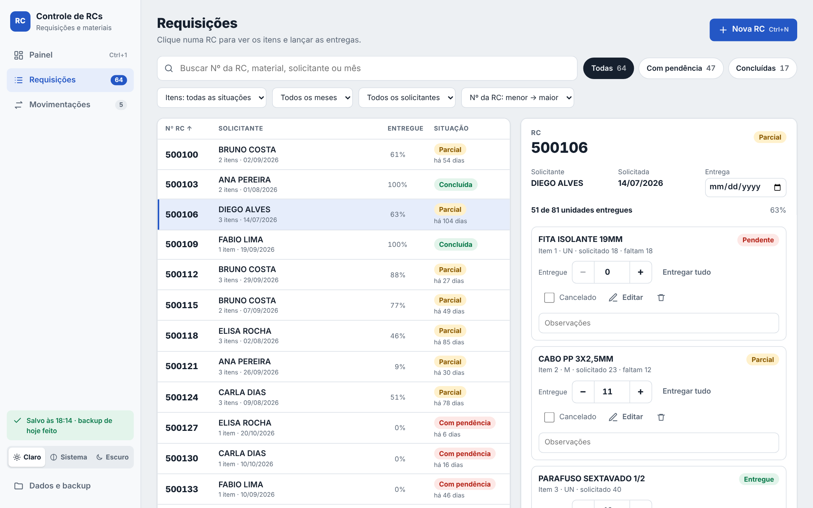
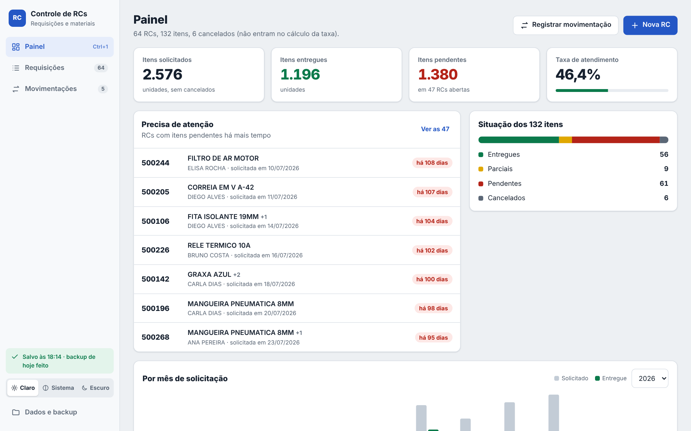
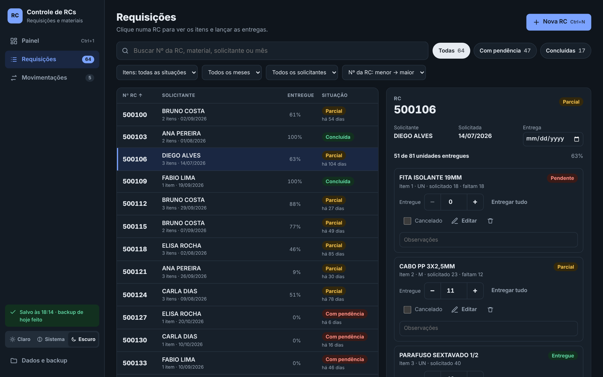
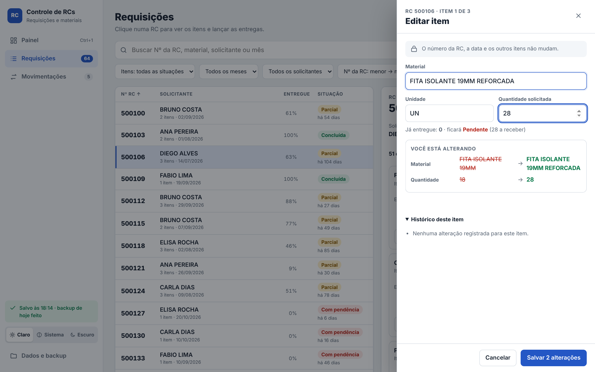
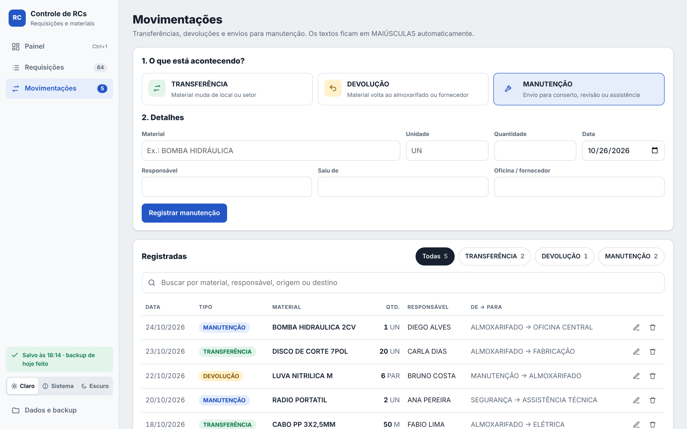

<div align="center">


# Controle de RCs

**Requisições de compra, entregas, transferências e manutenção, num só lugar.**<br>
Aplicativo para Windows que funciona **100% offline**, com os dados guardados no próprio computador.

[](https://github.com/Gui0ffx/controle-de-rcs/releases/latest)


<br>

<a href="https://github.com/Gui0ffx/controle-de-rcs/releases/latest">
  
</a>

<sub>Versão portátil: não precisa instalar nem de administrador.</sub>

<br><br>



</div>

---

## ✨ Destaques

<table>
<tr>
<td width="50%" valign="top">

### 📋 Lista + detalhe
Cada RC numa linha, com quanto já foi entregue e há quantos dias está esperando. Clique e os itens abrem ao lado.

### ➕ Entrega em um clique
Lance o que chegou com **− / +**, digitando ou com **Entregar tudo**. Salva na hora.

### 🔎 Encontre qualquer coisa
Busca por número, material, solicitante ou mês, sem se preocupar com acentos. Filtros rápidos: *Todas · Com pendência · Concluídas*.

### 🔢 Ordem certa
Ordenação numérica de verdade: 2 vem antes de 10. Crescente, decrescente ou por data, e a escolha fica salva.

</td>
<td width="50%" valign="top">

### 🚨 Precisa de atenção
O painel mostra as RCs paradas há mais tempo, com os dias de espera.

### ✏️ Edição com antes → depois
Corrija material e quantidade vendo exatamente o que vai mudar. Cada alteração fica no histórico do item.

### 🔧 Transferência, devolução e MANUTENÇÃO
Registre movimentações em dois passos, filtre por tipo e edite quando precisar.

### 🌗 Claro, escuro ou automático
Segue o tema do Windows ou o que você preferir. Textos sempre em **MAIÚSCULAS**, com acentos preservados.

</td>
</tr>
</table>

## 🖼️ Telas

<table>
<tr>
<td align="center"><br><sub><b>Painel</b>: indicadores e o que precisa de atenção</sub></td>
<td align="center"><br><sub><b>Tema escuro</b></sub></td>
</tr>
<tr>
<td align="center"><br><sub><b>Editar item</b>: antes → depois ao vivo</sub></td>
<td align="center"><br><sub><b>Movimentações</b>: com MANUTENÇÃO</sub></td>
</tr>
</table>

<sub>As telas usam dados fictícios.</sub>

## ⬇️ Instalação

1. Abra a página de [**Releases**](https://github.com/Gui0ffx/controle-de-rcs/releases/latest) e baixe:
   - **`ControleRC-Portatil-x.y.z.exe`**: dois cliques e pronto. Não instala nada e não pede administrador. **Recomendado.**
   - `ControleRC-Instalador-x.y.z.exe`: instala com atalho no menu Iniciar.
2. Na primeira vez, o Windows pode mostrar *"O Windows protegeu o computador"*, porque o arquivo não é assinado. Clique em **Mais informações → Executar assim mesmo**. Para conferir se o arquivo é o original, compare o hash com o `SHA256.txt` da mesma Release.

> [!TIP]
> **Atualizando de uma versão anterior?** Os dados ficam fora do aplicativo e são mantidos. Por segurança, copie antes a pasta `%LOCALAPPDATA%\ControleRC` e guarde o `.exe` antigo como reserva: ele continua abrindo os mesmos dados.

## ⌨️ Atalhos

| Atalho | Ação |
|---|---|
| <kbd>Ctrl</kbd> + <kbd>N</kbd> | Nova RC |
| <kbd>Ctrl</kbd> + <kbd>F</kbd> | Buscar |
| <kbd>Ctrl</kbd> + <kbd>1</kbd> / <kbd>2</kbd> / <kbd>3</kbd> | Painel / Requisições / Movimentações |
| <kbd>↑</kbd> <kbd>↓</kbd> | Andar pela lista de RCs |
| <kbd>Ctrl</kbd> + <kbd>R</kbd> | Recarregar a tela |
| <kbd>Alt</kbd> | Mostrar o menu do Windows |

## 💾 Seus dados

Tudo fica em `%LOCALAPPDATA%\ControleRC`, que você abre em **Dados e backup → Abrir pasta**:

```text
data\rcs.json               RCs e itens
data\transferencias.json    transferências, devoluções e manutenção
data\auditoria.json         histórico de edições
backups\diario\AAAA-MM-DD\  cópia diária automática (14 dias)
backups\eventos\...         cópia antes de excluir, importar ou apagar tudo
logs\app.log                log técnico, sem o conteúdo das RCs
```

- **Gravação segura:** cada alteração é gravada de forma atômica, e um arquivo danificado é recuperado sozinho a partir da cópia mais recente.
- **Exportar e importar:** CSV para o Excel, JSON para backup completo. Importar duas vezes não duplica nada.
- **Restaurar:** com o app fechado, copie os arquivos de `backups\diario\<data>\` de volta para `data\`.

## 🔒 Segurança e privacidade

- **Offline de verdade:** qualquer conexão de rede é bloqueada no processo principal e pela CSP. Sem telemetria e sem atualização automática.
- **Electron isolado:** `contextIsolation`, `sandbox` e sem `nodeIntegration`. O DevTools fica desligado na versão final, e navegação, novas janelas e permissões são negadas.
- **Entrada validada:** todo dado é normalizado por lista de campos permitidos, e o texto exibido é sempre escapado (proteção contra XSS). O CSV é protegido contra injeção de fórmula.
- **Sem criptografia própria:** os arquivos JSON ficam legíveis para o seu usuário do Windows. Use BitLocker e uma conta com senha se isso for um risco.

## ❓ Dúvidas frequentes

<details>
<summary><b>O app começou vazio. Cadê as minhas RCs?</b></summary>

Num computador novo o app começa sem dados: é só cadastrar. Se você já usava o Controle de RCs nesse PC, os dados continuam em `%LOCALAPPDATA%\ControleRC` e aparecem sozinhos. Para levar dados de outro PC, use **Dados e backup → Exportar dados (JSON)** lá e **Importar dados (JSON)** aqui.
</details>

<details>
<summary><b>A janela abriu toda escura ou preta.</b></summary>

Abra **Dados e backup → Modo de compatibilidade de vídeo**, ou aperte <kbd>Alt</kbd> e use **Ajuda → Tela preta?**. O app reabre desenhando a tela sem a placa de vídeo.
</details>

<details>
<summary><b>Preciso de internet?</b></summary>

Não. O app não faz nenhuma conexão: bloqueia todas, inclusive na própria tela.
</details>

## 📜 Novidades

Veja o que mudou em cada versão na página de [Releases](https://github.com/Gui0ffx/controle-de-rcs/releases).

<div align="center">
<br>
<sub>Feito por <a href="https://github.com/Gui0ffx">Gui0ffx</a></sub>
</div>
